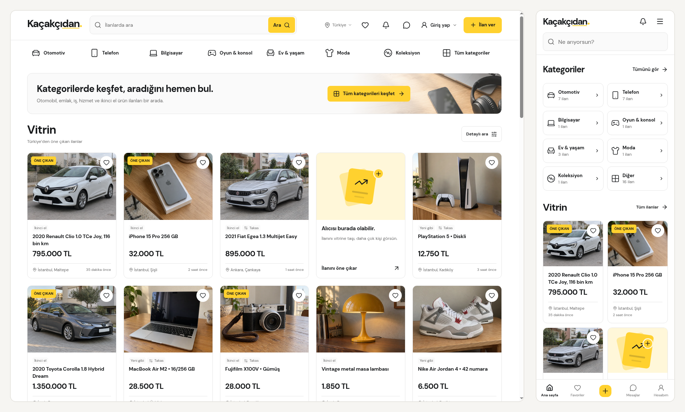

<h1 align="center">Kaçakçıdan</h1>

<p align="center"><strong>İkinci el online ilan ve alışveriş sitesi</strong></p>

<p align="center">Expo, React Native ve TypeScript ile web, iOS ve Android için geliştirildi.</p>

<p align="center">
  
  
  
  
  
</p>

<p align="center">
  
</p>

## Proje

Kaçakçıdan; ikinci el ürün, araç, emlak, iş ve hizmet ilanları için geliştirdiğim bir pazar yeri arayüzü. Aradığın ilana kolay ulaşmak, ilanları karşılaştırmak ve telefonda form doldurmak tasarımın temelinde yer alıyor.

Aynı kod tabanı web, iOS ve Android ekranlarını içeriyor. Yerleşim, menüler, klavye kullanımı ve açılır pencereler ekranın alanına göre değişiyor.

## Özellikler

- Kategori, alt kategori, marka ve model ile arama; yazarken öneriler ve ilan türüne göre teknik filtreler
- Fotoğraf galerisi, video, harita ve iki ilanı yan yana karşılaştırma
- Favoriler, mesajlar, ilan soruları ve cevapları, bildirimler
- Adımlı ilan oluşturma ve düzenleme; fotoğraf, fiyat, teslimat ve özellik seçimi
- Profil ve hesap ayarları; ilan yönetimi, görüntülenme ve favori sayıları
- Alışveriş ve teslim onayları, satıcı değerlendirmeleri, yorumlara yanıt verme
- Bütçe ve konumla alım talebi açma, bir ilanla talebe yanıt verme
- Açık, koyu ve sistem teması

## Kullanıcı deneyimi

Arama, kategoriler ve vitrin ana sayfada doğrudan görünür. Kategori menüsünde alt seçenekler aynı alan içinde ilerler; seçilen yol üzerinden geri dönülebilir. Teknik filtreler ve ilan formundaki alanlar kategoriye göre değişir. Kaydı bulunan modellerin sabit özellikleri otomatik gelir, renk ve kapasite gibi seçenekleri ilan sahibi belirler.

İlan görseli, fiyat ve özellikler geniş ekranda yan yanadır. Küçük ekranda içerik tek sütuna geçer, iletişim işlemleri alt alanda kalır. Karşılaştırma penceresinde iki ilan ayrı ayrı seçilip değiştirilebilir; görsele veya ilan bilgisine tıklamak ilgili ilanı açar.

Formlar kısa adımlara ayrılır. Önceki adıma dönünce girilen bilgiler korunur, hatalar ilgili alanın yanında gösterilir. Klavye açıldığında görünür alan ve odaklanan giriş izlenir. Menü ve pencerelerde klavye kullanımı, odak yönetimi ve sistemin hareket azaltma tercihi dikkate alınır.

## Performans

Web sayfaları derleme sırasında HTML olarak hazırlanır. Tam kategori ağacı, harita ve karşılaştırma içeriği gerektiğinde yüklenir. Arama metni hemen güncellenir; önerilerin hazırlanması yazı girişini bekletmez.

Görsellerin farklı genişlikte WebP kopyaları üretilir. İlk ekrandaki ilan görselleri öncelikli yüklenir, aşağıdaki görseller için tembel yükleme kullanılır. Fotoğrafların yeri önceden ayrılır; küçük önizlemelerde tam boy fotoğraf indirilmez.

Yerleşim ve veri akışına ilişkin ayrıntılar [geliştirme notlarında](./docs/README.md).

## Yerelde çalıştırma

Node.js `24.x` (en az `24.3.0`) ve npm gerekir.

```bash
npm ci
npm run web
```

Android için `npm run android`, iOS simülatörü için macOS ve Xcode üzerinde `npm run ios` kullanılabilir. Web çıktısını üretip yerelde açmak için:

```bash
npm run build
npm run preview
```

Kod ve biçim denetimi:

```bash
npm run check
npm run format:check
```

## Proje yapısı

```text
app/                    Expo Router sayfaları ve yönlendirmeler
src/bilesenler/         Ortak arayüz bileşenleri ve platform sürümleri
src/ekranlar/           Ekran içerikleri ve etkileşimleri
src/durum/              Hesap, ilan ve cihaz kayıtlarının yönetimi
src/tasarim/            Tema, yerleşim, klavye ve hareket davranışları
src/veri/               Kategoriler, ilanlar ve özellik tanımları
public/                 Görseller, yazı tipleri ve harita dosyaları
scripts/                Web çıktısını hazırlayan derleme adımları
docs/                   Arayüz, uygulama yapısı ve performans notları
screenshots/            README ekran görüntüleri
```

## Veriler

Bu depo uygulamanın ön yüzünü içeriyor. Hesap, ilan, favori, mesaj, alım talebi ve değerlendirme kayıtları kullanıldıkları tarayıcıda veya cihazda saklanır. Başka cihazlara aktarılmaz; mesajlar karşı tarafa iletilmez. Cihaz verilerini temizlemek bu kayıtları da siler.

Alışveriş ve değerlendirme akışları aynı cihazdaki hesaplar arasında kullanılabilir. Param Güvende satın alma talebi ve tutar özeti oluşturur; kart bilgisi veya ödeme alınmaz, para aktarılmaz. Merkezi üyelik, ödeme, kargo takibi ve bağımsız satıcı doğrulaması için sunucu hizmeti bulunmuyor. Harita, seçilen ilçe çevresini gösterir.

## Lisans

Kaçakçıdan’a ait özgün kodun telif hakkı © 2026 Teşkilatsız’dadır ve [PolyForm Noncommercial 1.0.0](./LICENSE) koşullarıyla yayımlanır. Kişisel ve hobi kullanımı gibi ticari olmayan kullanımlara izin verir; ticari kullanım için ayrıca yazılı izin gerekir. Lisans, belirli eğitim, yardım, kamu sağlığı ve kamu kurumlarının kullanımına fon kaynağından bağımsız izin verir.

Reacticx uyarlamaları ve ilçe koordinatları gibi üçüncü taraf içerikler kendi lisanslarında kalır. DM Sans yazı tipi [SIL Open Font License 1.1](./public/fonts/OFL.txt) ile lisanslanmıştır. Bağımlılıkların lisansları da kendi paketlerinde geçerlidir.

Önceki sürümlerde MIT lisansı yayımlandığı için bu değişiklik o sürümler için daha önce verilmiş izinleri geriye dönük olarak kaldırmaz.

Güvenlik açığı bildirimleri için [SECURITY.md](./SECURITY.md) dosyasındaki yolu kullanın.
