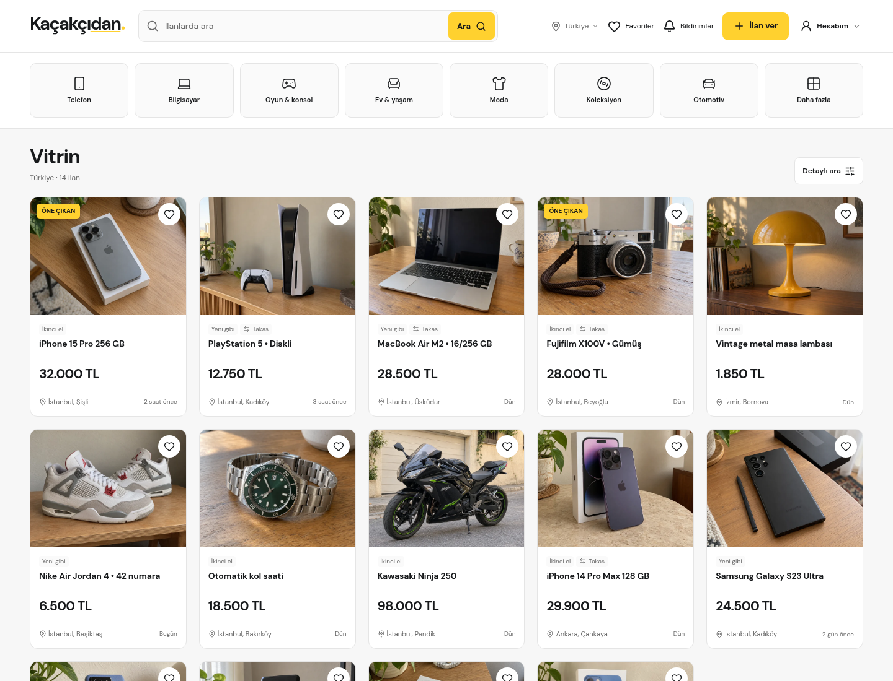
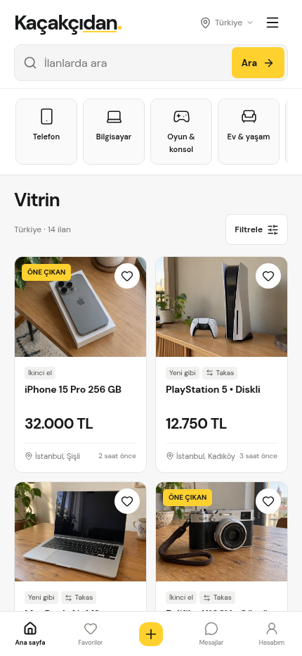

<h1 align="center">Kaçakçıdan</h1>

<p align="center"><strong>İkinci el online ilan ve alışveriş sitesi</strong></p>

<p align="center">
  Expo, React Native ve TypeScript ile web, iOS ve Android için geliştirildi.
</p>

<p align="center">
  
  
  
  
  
</p>

## Ekran görüntüleri

<p align="center">
  
  
</p>

## Proje

Kaçakçıdan, farklı kategorilerdeki ikinci el ilanları bulup paylaşmak için geliştirilmiş bir pazar yeri arayüzüdür. Arama ve kategori gezinmesiyle ilanlara ulaşabilir; ürün bilgilerini inceleyip satıcıyla iletişim kurabilirsiniz.

Arayüzü tasarlarken ilan bulma ve verme akışlarının anlaşılır olmasına, gerekli bilgilerin kolay karşılaştırılmasına ve web ile mobil ekranlarda rahat kullanılmasına odaklandım.

## Kullanım

- Kategori, marka ve modele göre gezinme; arama önerileri ve kategoriye uygun filtreler
- Fotoğraf ve video galerisi, ilan özellikleri, favoriler, mesajlaşma ve ilan hakkında soru-cevap
- İlan oluşturma ve düzenleme adımları, profil ve hesap ayarları
- Açık ve koyu tema; farklı ekran boyutlarına uyumlu sayfalar ve menüler

## Performans

Projede kullanılan ilan görselleri WebP biçimindedir; ekrandan uzaktaki görseller gecikmeli yüklenir. Arama sonuçları ve uzun ilan listeleri gereksiz yeniden çizimleri azaltacak şekilde düzenlenmiştir. Hareketler kısa tutulur ve azaltılmış hareket tercihi dikkate alınır.

## Yerelde çalıştırma

Node.js `24.x` (en az `24.3.0`) ve npm gerekir.

```bash
npm ci
npm run web
```

Android için `npm run android`, iOS simülatörü için macOS ve Xcode üzerinde `npm run ios` komutunu kullanabilirsiniz. Web derlemesini üretmek ve yerelde görüntülemek için:

```bash
npm run build
npm run preview
```

## Kontroller

```bash
npm run check
npm run format:check
npm run build
```

## Proje yapısı

```text
app/                    Expo Router yönlendirmeleri
src/bilesenler/         Ortak arayüz bileşenleri
src/ekranlar/           Uygulama ekranları
src/durum/              Uygulama ve cihazdaki kayıtların yönetimi
src/tasarim/            Tema ve ekran stilleri
src/veri/               Kategoriler, ilanlar ve filtre tanımları
public/                 Görseller, yazı tipleri ve diğer statik dosyalar
screenshots/            README ekran görüntüleri
```

## Veri saklama

Bu depoda sunucu bağlantısı bulunmuyor. Hesap, ilan, favori ve mesaj kayıtları kullanıldıkları tarayıcıda veya cihazda saklanır; cihazlar arasında eşitlenmez. Tarayıcı ya da uygulama verilerini temizlemek bu kayıtları da siler.

## Lisans

Kaynak kod [MIT lisansıyla](./LICENSE) yayımlanır. DM Sans yazı tipi kendi [OFL lisansına](./public/fonts/OFL.txt) tabidir.
