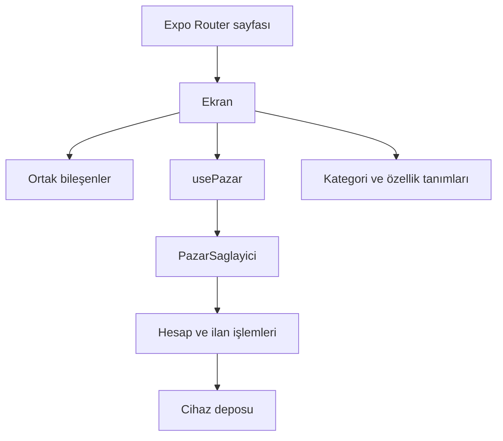

# Uygulama yapısı

## Dosyaların görevleri

`app/` adresleri ve sayfa metaverilerini tanımlar. Ekran içerikleri `src/ekranlar/`, ortak arayüz bileşenleri `src/bilesenler/` altındadır. Hesap ve ilan işlemleri `src/durum/`, kategori ve teknik özellik tanımları `src/veri/` içinde bulunur.

Platform davranışı ayrıştığında `.web.tsx` sürümü kullanılır. Örneğin web penceresi tarayıcının `dialog` öğesini, native pencere React Native bileşenlerini kullanır. Ortak prop tipleri iki sürümün aynı arayüzle kullanılmasını sağlar.

## İlk açılış

Katalog ilanları statik üretimde bilinir; başlık, kapak görseli ve temel içerik HTML'e yazılır. Kullanıcının eklediği ilanlar cihaz deposu okunduktan sonra bulunabilir. Sağlayıcının `hazir` bilgisi bu ayrımı yapar.

| Durum                         | Görünen içerik             |
| ----------------------------- | -------------------------- |
| İlan hazır                    | İlan içeriği               |
| İlan yok, kayıt okuma sürüyor | Gecikmeli yükleme iskeleti |
| İlan yok, okuma tamamlandı    | Bulunamadı ekranı          |

Yerel ilan adresi `/ilan/yerel?kayit=...` biçimindedir. Kayıt yalnız oluşturulduğu cihazda bulunur. Katalog ilanlarının adresleri `generateStaticParams` ile ayrı ayrı üretilir.

İlgili dosyalar: [ilan sayfası](../app/ilan/[id].tsx), [ilan ekranı](../src/ekranlar/IlanDetayi.tsx), [sağlayıcı](../src/durum/PazarSaglayici.tsx).

## Kayıtlar ve işlemler

Misafir kaydı, hesaplar ve etkin hesap kimliği ayrı tutulur. İlan, favori ve mesaj işlemleri etkin hesaba uygulanır. Depoya yazmalar sırayla yürütülür; eski bir yazmanın daha yeni kaydı ezmesi önlenir. Kayıtlar okunurken gelen işlemler de sırada tutulur.

Depodan gelen veri kullanılmadan önce doğrulanır ve gerekiyorsa güncel biçime dönüştürülür. Yeni bir alan eklendiğinde eski kayıtların nasıl okunacağı da bu katmanda belirlenir. İlan düzenlenirken ilan kimliği korunur.

Parolalar tuzlanmış PBKDF2 özetiyle saklanır. Bu işlem cihazdaki kayıtları merkezi bir üyelik hizmetine dönüştürmez. Veri erişiminin sunucuda denetlenmesi, cihazlar arasında eşitleme, ödeme ve teslimat doğrulaması bu deponun kapsamı dışındadır.

İlgili dosyalar: [hesap deposu](../src/durum/hesapDeposu.ts), [web parola işlemleri](../src/durum/parola.web.ts), [native parola işlemleri](../src/durum/parola.ts), [ilan etkileşimleri](../src/veri/ilanEtkilesimleri.ts).

## Sahiplik ve değerlendirmeler

Giriş gerektiren işlemler oturuma göre açılır. İlan yönetimi yalnız ilanın sahibine gösterilir; işlem katmanı da sahipliği ve geçerli durumu denetler.

Satıcı puanı ve değerlendirme sayısı kayıtlı yorumlardan hesaplanır. Yorum yazabilmek için alışverişte iki tarafın teslim onayı gerekir. Her alışveriş için bir değerlendirme yapılabilir. Satıcı yoruma yanıt verebilir, alıcının yorumunu silemez.

Bu kontroller aynı cihazdaki akışların tutarlılığını sağlar. Çok kullanıcılı bir hizmette yetki ve işlem denetimlerinin sunucuda da kurulması gerekir.

## Katalog ve model bilgileri

Kategori ağacı ilanların nerede bulunacağını, özellik tanımları form ve filtrelerde hangi alanların kullanılacağını belirler. Model kayıtları ise üreticiden bilinen sabit değerleri içerir. Kapasite ve renk gibi değişebilen seçenekler ilan sahibine bırakılır.

Tam katalog ortak bir yükleyiciden alınır. Eşzamanlı istekler aynı yüklemeyi paylaşır. Yükleme başarısızsa sonraki denemeye izin verilir.

İlgili dosyalar: [katalog yükleyicisi](../src/veri/kategoriKatalogu.ts), [model özellikleri](../src/veri/modelOzellikleri.ts), [özellik tanımları](../src/veri/ozellikler.ts).

## Paylaşım ve harita

Katalog ilanlarının paylaşım görselleri ve metaverileri derlemede hazırlanır. Uygulama içi gezinmelerde aynı bilgiler kullanılır. Ana sayfaya dönüldüğünde önceki ilanın ürün metaverisi temizlenir.

Harita ayrı bir iframe veya WebView içinde açılır. İşaretçi seçilen ilçe çevresini gösterir. “Nasıl giderim?” harici harita hizmetini kullanıcı isteğiyle açar; uygulama cihaz konum izni istemez.

İlgili dosyalar: [sayfa metaverisi](../src/bilesenler/SayfaMetasi.tsx), [web haritası](../src/bilesenler/HaritaGorunumu.web.tsx), [native harita](../src/bilesenler/HaritaGorunumu.tsx).

## Kaynaklar

- [Expo: statik üretim](https://docs.expo.dev/router/web/static-rendering/)
- [Expo: platforma özgü bileşenler](https://docs.expo.dev/router/advanced/platform-specific-modules/)
- [React: durumun yapısı](https://react.dev/learn/choosing-the-state-structure)
- [TypeScript: narrowing](https://www.typescriptlang.org/docs/handbook/2/narrowing.html)
- [MDN: Web Storage](https://developer.mozilla.org/en-US/docs/Web/API/Web_Storage_API)
