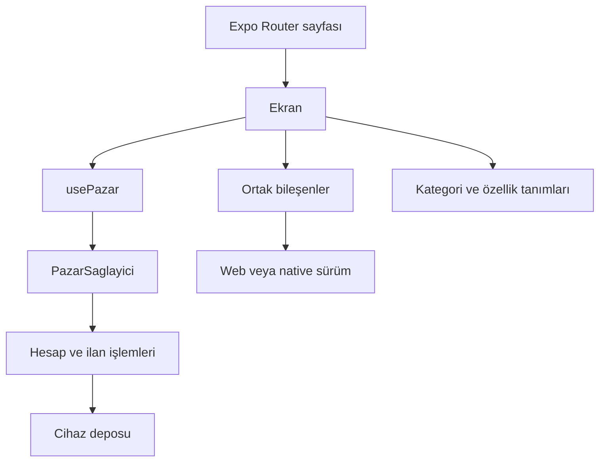

# Uygulama yapısı

## Sorumluluklar

`app/` adresleri ve sayfa metaverilerini tanımlar. Ekranın içeriği `src/ekranlar/` altında, tekrar kullanılan arayüzler `src/bilesenler/` altında bulunur. Hesap ve ilan işlemleri ekranlardan bağımsız olarak `src/durum/` içinde yürütülür. Kategori ve teknik özellik tanımları `src/veri/` katmanındadır.

Aynı bileşenin web ve native davranışı ayrışıyorsa `.web.tsx` sürümü kullanılır. Örneğin web galerisi ve penceresi tarayıcının öğelerini kullanırken native sürüm React Native bileşenlerini kullanır. Böylece her sürüm kendi platformunun araçlarıyla çalışır. Ortak prop tipleri farklı sürümlerin sözleşmesini korur.

Arayüzdeki hesap, satın alma ve mesaj durumları yerel kayıtlarla çalışır. Sunucu eklendiğinde veri erişimi ve yetkilendirme katmanının değişmesi gerekir; bileşendeki bir giriş kontrolü sunucu güvenliği sağlamaz.

## İlk açılış ve kayıtların okunması

Katalogdaki ilanlar statik üretim sırasında bilinir. Webde ilan başlığı, kapak görseli ve temel içerik HTML içinde hazırdır. Yerel kullanıcının eklediği ilanlar ise ancak cihaz deposu okunduktan sonra bilinebilir. Bunları aynı yükleme durumu gibi ele almak yanlış bir “ilan bulunamadı” ekranına yol açar.

`PazarSaglayici`, kayıt okuma tamamlandığında `hazir` bilgisini yayımlar. Bir ekranın henüz bulunamayan yerel kayıtla gerçekten bulunmayan kaydı ayırması gerekir:

| Durum                         | Ekranın davranışı          |
| ----------------------------- | -------------------------- |
| İlan hazır                    | İçeriği göster             |
| İlan yok, kayıt okuma sürüyor | Gecikmeli iskelet göster   |
| İlan yok, okuma tamamlandı    | Bulunamadı durumunu göster |

Yerel ilan adresi `/ilan/yerel?kayit=...` biçimindedir. Statik çıktı bu ortak sayfayı içerir. Kullanıcının tarayıcısında oluşmuş bir ilanın başka bir cihazda aynı içerikle bulunacağı varsayılmaz. Katalog ilanlarının bilinen adresleri `generateStaticParams` ile ayrı ayrı üretilir.

İlgili dosyalar: [ilan sayfası](../app/ilan/[id].tsx), [ilan ekranı](../src/ekranlar/IlanDetayi.tsx), [sağlayıcı](../src/durum/PazarSaglayici.tsx).

## Yerel kayıtların tutarlılığı

Hesap deposunda misafir kaydı, hesaplar ve aktif hesap kimliği ayrıdır. İlan, favori ve mesaj işlemleri aktif kayda uygulanır. Bekleyen yazmalar sıralanır; geç tamamlanan eski bir yazmanın yeni veriyi ezmesi önlenir. Depo okunurken oluşan işlemler de kaybolmaması için sırada tutulur.

Kayıt okuma, doğrulama ve eski biçimleri dönüştürme ekranın işi değildir. `hesapDeposu.ts` bu sınırı yönetir. Ürün durumunun üç seçenekten iki seçeneğe geçmesi buna örnek: eski “Yeni gibi” değeri doğrulama öncesinde “İkinci el”e çevrilir. Eski kayıt tümden reddedilmez; oturum, favoriler ve medyaya ait kimlikler korunur. Yeni oluşturma ve düzenleme işlemleri yalnız tanımlı iki durumu kabul eder.

İlanın düzenlenmesi kimliğini değiştirmez. Yeni ilan numarası atama ve mevcut numarayı koruma ayrı işlemlerdir. Filtrelenmiş listenin sırası veya görselin dosya adı ilan kimliği olarak kullanılmaz.

Parola açık metin olarak saklanmaz; webde Web Crypto, native tarafta uygun karma hesabı kullanılır. Bununla birlikte, aynı cihazdaki kayıtlar merkezi bir kimlik doğrulama sistemi değildir. Kullanıcı verisine erişimin sunucuda denetlenmesi bu deponun kapsamı dışındadır.

İlgili dosyalar: [hesap deposu](../src/durum/hesapDeposu.ts), [durum seçenekleri](../src/veri/ilanDurumu.ts), [parola](../src/durum/parola.web.ts), [ilan etkileşimleri](../src/veri/ilanEtkilesimleri.ts).

## Türetilen bilgiler ve görünürlük

Satıcı puanı, değerlendirme sayısı ve ilan istatistikleri mevcut kayıtlardan hesaplanır. Kayıt bulunmaması olumlu değerlendirme veya doğrulama olarak yorumlanmaz. Değerlendirme hakkı, alışverişteki teslim onaylarıyla ilişkilidir. Aynı alışveriş için ikinci yorum oluşturulamaz; satıcı yoruma yanıt verebilir, alıcının yorumunu silemez.

Hesap gerektiren işlemler arayüzde oturuma göre açılır. Favoriye ekleme veya ilan yönetimi giriş gerektirir. İlan sahibine ait düğmeler başka bir hesabın ilanında gösterilmez. İşlem katmanı da sahiplik ve geçerli durum kontrolü yapar; yalnız düğmeyi gizlemeye dayanmaz.

Bu kontroller yerel akışın tutarlılığı içindir. Ayrı cihazlar, eşzamanlı kullanıcılar, gerçek ödeme ve teslimat doğrulaması için sunucu tarafında yeniden kurulmaları gerekir.

## Katalog ve model bilgileri

Kategori ağacı, özellik tanımları ve üreticiden gelen sabit model bilgileri farklı sorulara cevap verir. Kategori nerede aranacağını, özellik tanımı hangi bilgilerin sorulacağını, model kaydı hangi değerlerin önceden bilindiğini belirler.

Tam katalog ilk sayfaya taşınmaz. Ana kategorilerin bağlantıları küçük bir yardımcıyla üretilir; ayrıntılı ağaç gerektiğinde ortak bir Promise üzerinden yüklenir. Aynı anda iki bileşenin katalog istemesi iki ayrı indirme başlatmaz. Başarısız yüklemenin sonraki denemeleri kalıcı olarak zehirlememesi için hata durumunda önbellek sıfırlanır.

İlgili dosyalar: [katalog yükleyicisi](../src/veri/kategoriKatalogu.ts), [ana kategori adresi](../src/veri/anaKategoriAdresi.ts), [model özellikleri](../src/veri/modelOzellikleri.ts), [özellik tanımları](../src/veri/ozellikler.ts).

## Paylaşım ve harita

Katalog ilanlarının paylaşım görselleri ve metaverileri derleme sırasında hazırlanır. İlk HTML ile uygulama içi gezinmenin başlıkları aynı bilgiyi kullanır. Ana sayfada zaten hazır metaveriyi yeniden kurmak için bütün güncelleyici yüklenmez; gezinti başladığında yüklenir. Başka bir sayfadan ana sayfaya dönüldüğünde önceki ilanın ürün verisi temizlenir.

Harita ayrı bir iframe/WebView içindedir. Uygulama koduyla harita kütüphanesi aynı ilk paketi paylaşmaz. Konum sekmesi açılmadan karo isteği yapılmaz. İşaretçi seçilen ilçe çevresini gösterir; açık adres veya GPS doğruluğu iddia edilmez. “Nasıl giderim?” kullanıcı isteğiyle harici harita hizmetini açar, uygulama kendiliğinden cihaz konum izni istemez.

## Değişiklik yaparken

- Yeni bir kayıt alanı eklenirse eski verinin nasıl okunacağı da belirlenir. Yalnız TypeScript tipini değiştirmek yetmez.
- Bir bileşenin web davranışı değişirse native prop sözleşmesi korunur; DOM olayları native bileşene veya `onPress` ham HTML öğesine taşınmaz.
- Yeni bir dış kaynak, veri aktarımı veya kalıcı kayıt eklenirse gizlilik ve depolama metinleri de güncellenir.

## Kaynaklar

- [Expo: statik üretim](https://docs.expo.dev/router/web/static-rendering/)
- [Expo: platforma özgü bileşenler](https://docs.expo.dev/router/advanced/platform-specific-modules/)
- [React: durumun yapısı](https://react.dev/learn/choosing-the-state-structure)
- [TypeScript: narrowing](https://www.typescriptlang.org/docs/handbook/2/narrowing.html)
- [MDN: Web Storage](https://developer.mozilla.org/en-US/docs/Web/API/Web_Storage_API)
